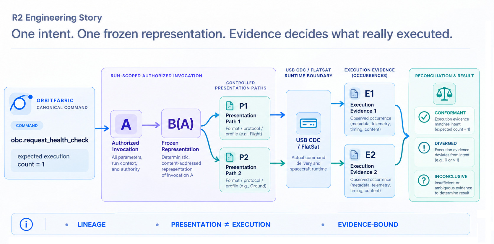
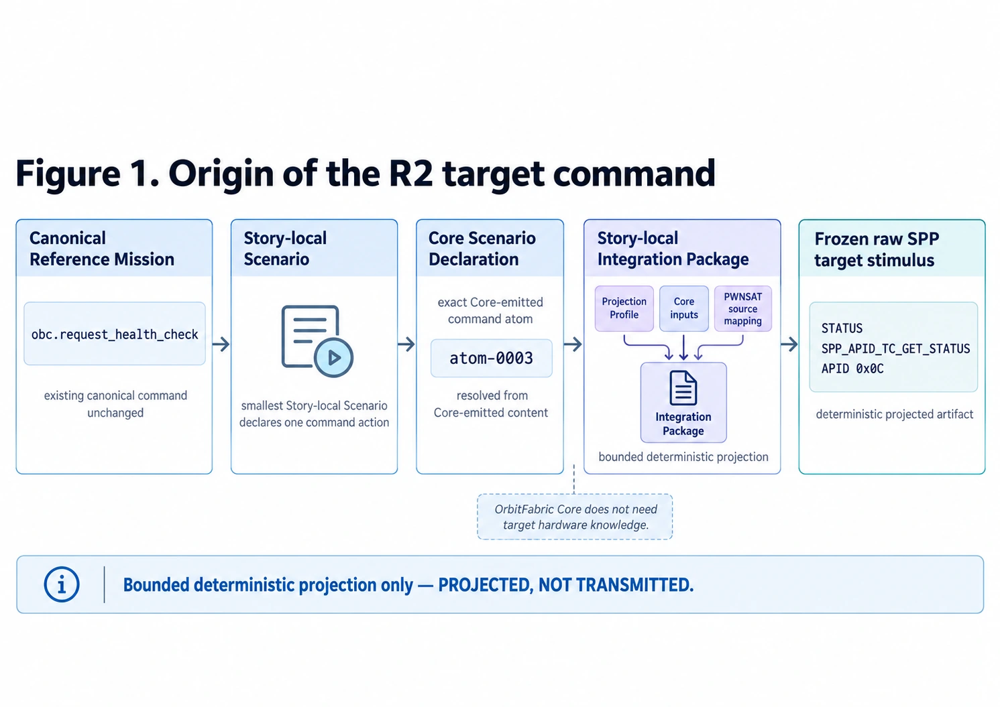
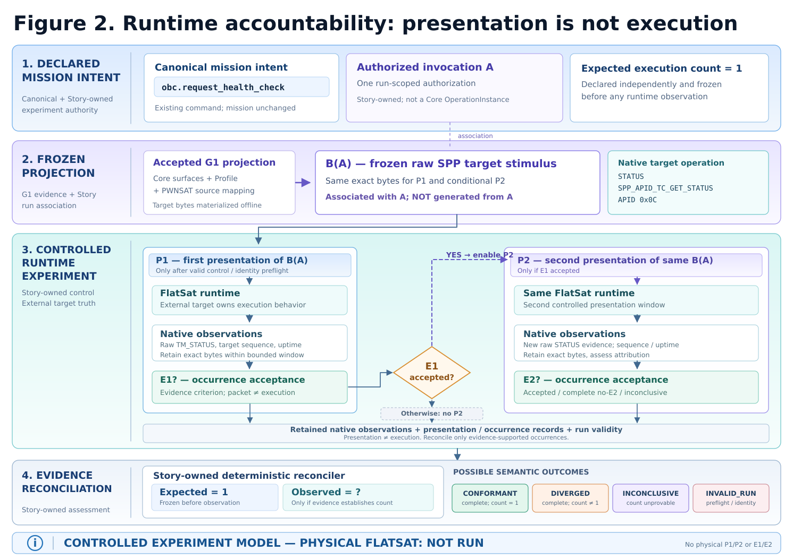

*R1 worked. R2 began when I stopped asking how to demonstrate the architecture and started asking how to make it prove something I did not already control.*

R1 established the result I needed: one mission-level semantic root could cross independently owned flight and ground systems, preserve native authority on both sides, and still converge in a real runtime loop.

That was useful. It also created the next problem.

Once an architecture starts producing the results you expect, how do you stop proving it to yourself?

For R2 I wanted something outside [OrbitFabric](https://github.com/OrbitFabric/orbitfabric/blob/main/docs/ARCHITECTURE.md). Not another fixture whose behavior I could define, and not another integration where the proof harness ultimately knew both the question and the answer. I wanted a runtime with its own implementation, its own command handling and its own evidence.

The question changed accordingly:

> Can one mission intent remain accountable through what an external runtime actually does?

That led me to [PWNSAT/FlatSat](https://github.com/Pwnsat/FlatSat).

---

## A spacecraft-shaped target

PWNSAT is difficult not to notice if you like spacecraft software and slightly adversarial test environments.

Its ecosystem is deliberately security-oriented. There are vulnerable spacecraft targets, attack tooling and hands-on experimentation around actual command and telemetry paths. That part certainly made it interesting.

But R2 is not a cybersecurity Story.

The useful property was simpler: PWNSAT gave me a concrete spacecraft runtime whose implementation I could inspect without owning it.

FlatSat in particular was attractive. There is a real RP2040-based OBC, two SX1262 radios, a wired USB CDC path for laboratory operation, Space-Packet-style telecommands and telemetry, and firmware source that exposes the command dispatcher rather than hiding it behind a simulator API.

That was enough hardware reality for R2.

Before writing any OrbitFabric integration, I opened the source.

One command stood out:

```text
GET_STATUS
APID 0x0C
```

The firmware dispatch for `GET_STATUS` calls the mission-status telemetry function directly. That function builds:

```text
TM_STATUS
APID 0x0C
```

The returned status contains native runtime state, including spacecraft uptime. The Space Packet primary header also carries the target-maintained telemetry sequence count.

So I had something unusually useful for this experiment:

```text
GET_STATUS
    ↓
real FlatSat command dispatcher
    ↓
TM_STATUS
    ↓
native sequence identity
+
native uptime progression
```

Not an OrbitFabric acknowledgement.

Not a Story-generated receipt.

Target-produced evidence.

That was the first important R2 ingredient.

---

## I went back to the mission

At this point it would have been very easy to invent a new OrbitFabric command called something convenient like `pwnsat.get_status`.

That would also have been exactly the wrong experiment.

I went back to the canonical [OrbitFabric Reference Mission](https://github.com/OrbitFabric/orbitfabric-reference-mission) instead.

The command I needed was already there:

```text
obc.request_health_check
```

The canonical source already defines [obc.request_health_check](https://github.com/OrbitFabric/orbitfabric-reference-mission/blob/main/mission/commands.yaml).

Perfect.

It had not been created for PWNSAT, for FlatSat, or for R2. It already belonged to the mission model.

That changed the direction of the integration. I did not have to modify the canonical mission until it resembled the target. I had to show how an existing mission intent could be carried toward a target that had never heard of OrbitFabric.

R2 therefore leaves the canonical Reference Mission unchanged.

It also leaves the canonical top-level Scenario set unchanged.

Instead, the Reference Project adds the smallest Story-local Scenario needed for the experiment: invoke the existing `obc.request_health_check` command once.

Core validates that Scenario and emits the corresponding [Scenario Declaration](https://github.com/OrbitFabric/orbitfabric/blob/main/docs/reference/scenario-declaration-surface.md). The implementation then resolves the exact command atom from the content Core actually emitted; it does not predict the atom identity from its position in YAML or from an assumption about how Core will serialize the Scenario.

That detail is small enough to miss.

It is also exactly the kind of shortcut that later turns provenance into folklore.

The Story-local PWNSAT [Projection Profile](https://github.com/OrbitFabric/orbitfabric/blob/main/docs/reference/projection-profile-contract.md) then binds that canonical command identity to the FlatSat operation established from source:

```text
STATUS
SPP_APID_TC_GET_STATUS
APID 0x0C
```

That is the first complete OrbitFabric-to-PWNSAT line in R2.



*Figure 1. Origin of the R2 target command. The existing `obc.request_health_check` identity comes from the canonical Reference Mission, is invoked by the smallest Story-local Scenario, passes through the Core Scenario Declaration to the exact Core-emitted command atom, and is then bound by the Story-local PWNSAT Projection Profile to FlatSat `STATUS / SPP_APID_TC_GET_STATUS / APID 0x0C`.*

This was a bounded command projection, not a claim that FlatSat implemented every behavior associated with the canonical health-check operation.

Nothing about that required Core to learn what an RP2040 was.

Good.

---

## The wire was more interesting than expected

The USB path added another useful boundary.

A telecommand does not travel over USB as bare Space Packet bytes. FlatSat expects an ingress envelope:

```text
0xAA 0x55
+ big-endian payload length
+ raw SPP packet
```

Telemetry comes back differently:

```text
0xAA
+ raw SPP packet
```

The receive side recovers packet boundaries using the length encoded in the Space Packet primary header.

So the path is asymmetric.

That sounds like a minor transport detail until the experiment needs to identify exactly what was presented.

I did not want the USB envelope to become part of the mission command identity merely because the wire required it. The projected object therefore remains the raw target Space Packet. USB framing is applied later, at the physical runtime boundary.

The distinction ended up encoded in the harness itself: it verifies the frozen raw stimulus first, then wraps those exact bytes for USB transmission.

That gives R2 a clean seam:

```text
mission projection
    ↓
frozen raw SPP representation
    ↓
runtime transport envelope
    ↓
FlatSat
```

For a moment I considered whether any of this belonged in Core.

Then the question answered itself.

If I was about to teach Core that FlatSat ingress begins with `0xAA 0x55`, I was almost certainly solving the problem in the wrong layer.

Core carries mission meaning and emits the Scenario information needed by the integration.

The PWNSAT projection knows how that meaning maps to a target command.

The runtime harness knows how those target bytes cross USB.

FlatSat owns what happens after they arrive.

The telemetry sequence counter, uptime field and execution-occurrence rules stayed out of Core for the same reason.

Those are real and important R2 facts.

They are not universal OrbitFabric semantics.

---

## My first diagram was wrong

The obvious model was:

```text
obc.request_health_check
        ↓
     FlatSat
        ↓
     TM_STATUS
```

It lasted until I asked one question:

What happens if I send the exact same command twice?

Not *two commands that mean the same thing*.

The same projected bytes.

Twice.

What, exactly, would have happened twice?

The mission operation would not suddenly become two mission operations.

The experiment would still have authorized only one invocation.

The representation would not have changed.

Only the act of presenting that representation to the external runtime would have happened twice.

Whether FlatSat executed it twice would be a different fact.

That forced the R2 model into existence.

The canonical mission operation is:

```text
obc.request_health_check
```

For one bounded execution attempt, the Story anchors that operation to one run-scoped authorized invocation:

```text
A
```

The authorization is intentionally Story-owned. It is not a new OrbitFabric Core semantic.

The projection lineage independently gives me the exact target representation for the canonical command. For this run, I freeze that representation and associate it with `A`:

```text
B(A)
```

The notation is useful because it preserves the relationship for the experiment. It does not mean that the target bytes are mathematically generated from the identity of `A`.

The experiment then provides two controlled presentation opportunities:

```text
P1
P2
```

The runtime may provide evidence for execution occurrences:

```text
E1
E2
```

or it may not.

The model had become:

```text
mission meaning
    ↓
run-scoped authorized invocation A
    ↓
frozen projected representation
associated with A: B(A)
    ↓
 P1       P2
  \       /
   \     /
    FlatSat
       ↓
native observations
       ↓
possible E1 / E2
       ↓
reconciliation
```

**But a presentation is not an execution.**

That sentence became the hinge of R2.

---

> ### A real mission reminder
>
> [NASA/JPL's Lessons Learned record for Ulysses](https://llis.nasa.gov/lesson/1415) describes two occasions on which an operational command was transmitted twice. The duplicate commands were stored aboard the spacecraft, produced a data-buffer overflow and caused later operational instructions to be rejected until the onboard instruction set was restored.
>
> R2 does not reproduce the Ulysses event and does not model its command system. The connection is narrower: mission intent, command transmission and onboard behavior are not automatically the same fact, and multiplicity can have operational consequences.

---

## One execution was the expectation before anything ran

The experiment needed an expectation that existed independently of FlatSat.

For the first R2 proof it is intentionally small:

```text
expected_execution_count = 1
```

That value belongs to the Story-level experiment definition.

It is fixed before runtime observation.

This matters because otherwise an observed count has nothing to diverge from. If FlatSat eventually gives us evidence for two executions, the number `2` is simply an observation until there is an independently declared expectation of `1`.

The reverse is equally important.

The expected value cannot tell us what FlatSat actually did.

So R2 keeps two quantities apart:

```text
expected execution multiplicity
```

and, only when evidence supports it:

```text
observed execution multiplicity
```

Reconciliation comes later.

---

## Freeze first, present later

Once I had separated invocation from presentation, the next constraint became obvious.

If `P1` and `P2` used different command representations, any difference downstream would be uninterpretable.

Maybe the runtime behaved differently.

Maybe I changed the input.

So the target representation is frozen before runtime work begins.

The lineage is now concrete:

```text
Reference Mission
    ↓
obc.request_health_check
    ↓
Story-local Scenario
    ↓
Core Scenario Declaration
    ↓
exact Core-emitted command atom
    ↓
PWNSAT Projection Profile
    ↓
STATUS / GET_STATUS / APID 0x0C
    ↓
frozen raw SPP representation
associated with A: B(A)
```

At runtime, the harness refuses to substitute another stimulus silently. A changed byte is not "close enough". The presentation primitive rejects it before transmission.

That test exists.

It passes.

The runtime experiment is therefore not allowed to regenerate a convenient new command and still call it the same `B(A)`.

---

## Then I had to decide what counts as execution

At this point I could prove exactly which bytes the harness was prepared to present.

I still could not prove that FlatSat had executed the command.

`TM_STATUS` looked like the obvious answer.

Unfortunately, "I saw a STATUS packet" is not a sufficient occurrence criterion.

There are several ways that statement can lie without any packet being malformed.

The observation channel could contain an older packet.

A second producer could issue its own `GET_STATUS`.

A capture layer could duplicate data.

Two candidate responses could appear in the same bounded window.

A later packet could have the same target sequence identity as the earlier one.

Runtime state could move backwards in a way that makes the supposed ordering suspect.

So the occurrence rule became intentionally stricter than "response received".

For the pinned FlatSat path, an accepted execution occurrence needs the exact frozen presentation, a bounded and cleared observation window, target-produced STATUS telemetry, no competing STATUS-command source, distinguishable raw evidence, distinct native telemetry sequencing where a second occurrence is claimed, and runtime progression consistent with the supposed ordering.

A STATUS packet alone does not get promoted to `E1` or `E2`.

That turned out to be one of the most useful constraints in the whole experiment.

Core knows none of these rules.

It should not.

They exist because of what this particular external runtime exposes as evidence and because of what this particular Story is trying to establish.

---

## One tool had to leave the bench

PWNSAT-C3 is useful software. Its ground side can generate commands, decode telemetry and expose a browser interface.

For the R2 proof, that convenience created a problem.

If another component is allowed to generate STATUS requests during the bounded experiment, a perfectly valid `TM_STATUS` can arrive and still be useless as occurrence evidence: I no longer know whether it belongs to `P1`, `P2` or somebody else's request.

So the mandatory proof path excludes competing STATUS producers, including UI-driven polling.

That was a slightly counterintuitive design improvement.

Removing a useful observer made the experiment more observable.

The controlled path became deliberately narrower:

```text
frozen B(A)
    ↓
R2 presentation harness
    ↓
wired USB CDC
    ↓
FlatSat
    ↓
raw TM_STATUS
    ↓
R2 evidence capture
```

RF remained out.

PWNCUBE remained out.

The browser was not needed to make the result look more spacecraft-like.

The wired path offered a sufficiently narrow way to test the architectural question, without introducing RF into the proof.

---

## The bench started to take shape

By then the experiment had acquired real machinery:

```text
mission intent
    ↓
Story-local Scenario
    ↓
Core-emitted command atom
    ↓
PWNSAT projection lineage
    ↓
frozen target representation
    ↓
USB runtime framing
    ↓
FlatSat command processing
    ↓
TM_STATUS / native runtime observations
    ↓
retained raw evidence
    ↓
execution-occurrence acceptance
    ↓
expected-vs-observed reconciliation
```

Each boundary exists for a different reason.

The Scenario preserves the connection to the existing mission intent. Core makes the exact command atom explicit. The experiment definition adds the run-scoped expectation without changing Core semantics. The frozen representation makes repeated presentation comparable. The USB layer reaches the real target without becoming command meaning. The native response keeps execution evidence downstream-owned. The retained raw bytes make the result independently inspectable after the run.

Somewhere around here I made the mistake of imagining the entire chain in [OrbitFabric Studio](https://github.com/OrbitFabric/orbitfabric-studio).

```text
request_health_check
    ↓
Scenario atom
    ↓
PWNSAT projection
    ↓
B(A)
   ↙ ↘
 P1   P2
   \ /
 E1? E2?
   ↓
evidence
   ↓
reconciliation
```

For an engineer trying to understand *why* a result exists, that could become a rather compelling semantic path to explore visually.

I parked the thought before R2 turned into a Studio project.

Studio does not currently need to understand these Story-local runtime-occurrence semantics for R2 to work.

Back to the bench.



*Figure 2. The R2 runtime-accountability path. One mission intent is anchored to run-scoped invocation `A`; the exact projected target representation is frozen and associated with it as `B(A)`. Controlled presentations `P1` and `P2` cross into FlatSat; target-owned observations are evaluated as possible execution occurrences before the Story reconciles expected count `1` with whatever observed count the retained evidence can actually support.*

---

## I split the offline proof in two

Before touching hardware, I split the proof into two offline checkpoints.

I called them G0 and G1.

G0 would test whether the execution-accounting model itself was deterministic and capable of disagreeing with me.

G1 would attach that model to a real, source-grounded PWNSAT projection without pretending that projection meant execution.

That separation kept two different questions from becoming one test.

---

## G0 deliberately had no spacecraft

G0 established the Story-local experiment model, deterministic run-scoped identity and four possible reconciliation states without a PWNSAT runtime.

That was intentional.

If I could not make the accounting deterministic with synthetic evidence, adding a serial port would not improve it.

The model had to support:

```text
CONFORMANT
DIVERGED
INCONCLUSIVE
INVALID_RUN
```

Those are semantic results, not test statuses.

`CONFORMANT` means a valid run produced complete evidence and the observed execution count equals the expected count.

`DIVERGED` means the evidence is complete but the counts differ.

`INCONCLUSIVE` means the run reached the observation problem but the evidence cannot establish occurrence multiplicity safely.

`INVALID_RUN` means a required experimental precondition was violated, so the comparison itself would be unsound.

The important part was that none of those outcomes was hard-coded as the result R2 wanted.

G0 also kept its new machinery deliberately local to the Story.

There was no need for a generic Core `Presentation`, `ExecutionOccurrence`, `ResponseInstance` or `OperationInstance` model.

The experiment needed those distinctions.

That did not automatically make them platform concepts.

---

## G1 attached the model to real target source

G1 replaced synthetic projection placeholders with a source-grounded PWNSAT lineage.

The operation remained:

```text
obc.request_health_check
```

The Story-local Scenario still invoked the existing Reference Mission command once.

Core still validated that Scenario, emitted the Scenario Declaration and exposed the exact command atom the implementation resolved from that output.

The PWNSAT Projection Profile bound that canonical command identity to the source-established FlatSat `STATUS` operation.

The result was the exact frozen raw SPP representation later intended for physical presentation and associated with the run-scoped invocation as `B(A)`.

No command was transmitted.

No FlatSat executed.

No `TM_STATUS` was observed.

That separation is easy to lose in a project that generates very convincing binary artifacts. A valid Space Packet on disk is still only a projected artifact.

I wanted the Story to be able to say exactly that before any serial port was opened.

---

## Then I tried to make the harness lie

The runtime harness was the point where the experiment could easily become self-confirming.

So most of the interesting tests are not happy-path tests.

One test modifies the frozen stimulus by one byte.

The harness refuses to present it.

Another gives `P1` two plausible STATUS candidates inside the same observation window.

That is not "two executions".

The result is ambiguous.

The harness returns:

```text
INCONCLUSIVE
```

and, importantly, it does not proceed to `P2`.

That behavior matters. If the nominal first occurrence cannot be established independently, applying the second presentation would only contaminate an already uncertain run.

Another test gives the supposed second response a changed uptime but the same telemetry sequence count as the first.

No `E2`.

Ambiguous.

Another advances the telemetry sequence but makes target uptime regress.

Again, no accepted `E2`.

Another violates the controlled-runtime precondition.

The result is:

```text
INVALID_RUN
```

with zero command writes.

That is the kind of failure I wanted.

The harness should fail before touching the target when the experiment is not entitled to make the inference it was designed to make.

---

## A good test returned "I don't know"

The most satisfying result was not `DIVERGED`.

It was `INCONCLUSIVE`.

A tempting implementation would count packets and produce an answer.

Two packets? Two executions.

Simple.

Wrong.

The actual harness is allowed to see apparently useful evidence and decline to turn it into an occurrence count.

That gives ambiguity operational meaning without inventing a new generic OrbitFabric ambiguity model.

It simply says:

```text
the evidence retained for this run
does not justify the execution count
```

Good.

The harness refused to decide.

That is stronger than forcing a binary verdict, especially in a Story whose purpose is to keep ownership honest.

---

## And yes, the other outcomes are tested too

The offline runtime double can produce two distinct target-style STATUS observations with progressing native sequence and uptime state.

With:

```text
expected = 1
observed = 2
```

the reconciler returns:

```text
DIVERGED
```

That is a harness test, not a FlatSat result.

The double can also produce a valid first occurrence and no independently established second one.

With complete observation:

```text
expected = 1
observed = 1
```

the result is:

```text
CONFORMANT
```

That is also a harness test, not a FlatSat result.

This second case matters as much as the first.

If physical FlatSat later behaves that way, it falsifies the multiplicity pressure case suggested by the Story title and still represents a successful R2 experiment.

R2 does not require FlatSat to misbehave.

It requires the harness to tell the truth about whatever FlatSat does.

---

## The evidence had to survive after the process exited

Runtime logs were not enough.

The harness retains the raw USB observation stream and the raw SPP packets associated with each presentation window. It also records the native fields used to distinguish accepted occurrences.

The resulting evidence bundle binds those runtime artifacts back to the experiment definition and to the already accepted G1 projection artifacts.

A verifier can then work from retained bytes rather than from a Python process's memory of what happened.

One falsification test mutates a retained raw occurrence packet after the synthetic run.

The bundle verifier rejects it.

Another executes the same deterministic synthetic transport case cleanly twice and checks that the retained identities reproduce.

The runtime implementation currently passes all 33 offline tests.

That number is useful only for one reason: the software side of the question is no longer hypothetical.

The physical answer still is.

---

## I stopped to check what I had built

There was a point where R2 had Story schemas, target mappings, transport parsing, raw evidence capture, occurrence criteria, experiment definitions and a reconciler.

That triggered an uncomfortable question:

> Am I still testing OrbitFabric, or have I accidentally built an elaborate PWNSAT test framework?

It was worth checking.

Mission meaning still comes from the canonical Reference Mission.

The Story-local Scenario selects one existing command without redefining the mission.

Core validates it, emits the Scenario Declaration and exposes the exact command atom, but remains ignorant of USB framing and runtime occurrence accounting.

The PWNSAT Projection Profile owns the target binding.

The run-scoped expectation remains Story-owned.

The frozen target representation comes from the projection lineage and is associated with the authorized invocation for the bounded run.

PWNSAT owns what its firmware does with those bytes.

The target produces the observations used to establish occurrences.

The Story retains and reconciles those observations.

OrbitFabric never becomes the authority that says, "I sent it, therefore it executed."

That kept the architecture on the right side of the boundary.

It also explained why the runtime structures remained Story-local.

They existed because R2 needed them.

That was not sufficient reason to turn them into Core semantics.

---

## The live boundary became very small

By the end of the offline work, the physical procedure had become almost boring.

That is a compliment.

Before execution, verify the complete lineage back to `obc.request_health_check`.

Verify the exact frozen stimulus.

Establish that the FlatSat is controlled.

Establish that the R2 harness is the exclusive command source.

Clear the observation path.

Then:

```text
P1
 ↓
bounded observation
 ↓
accept E1 or stop honestly
```

Only if the nominal occurrence is independently established:

```text
P2
 ↓
bounded observation
 ↓
accept E2
or establish no E2
or remain INCONCLUSIVE
```

Then seal what actually happened and reconcile it against:

```text
expected_execution_count = 1
```

No special runtime behavior needs to be added to PWNSAT.

No firmware modification is part of the experiment.

That matters. If I had to modify the target to manufacture the evidence model I wanted, the external-runtime claim would already be weaker.

---

## The CI result is intentionally unexciting

Repository CI exercises the complete offline side of the runtime harness.

It does not open a serial port.

It does not probe for FlatSat hardware.

It does not manufacture `P1` or `P2`.

It does not manufacture `E1` or `E2`.

The live serial dependency can be initialized against no port, so the software boundary is checked without accidentally turning preflight into an experiment.

The observation report for that environment says, explicitly:

```text
runtime: NOT_RUN
```

with no presentations, no execution occurrences, no observed execution count and no semantic assessment.

That is exactly the correct CI result.

The exact machinery lives in the [R2 Reference Project](https://github.com/OrbitFabric/orbitfabric-reference-mission/tree/76ed6471f7726a006d7f5a72bde1e1110026f2fd/engineering-stories/02-one-intent-two-executions/reference-project): schemas, Profile, Story-local Scenario, source baselines, binary artifacts, scripts, tests, hashes and eventually retained physical evidence. The Story only needs enough of that machinery to explain why the result can be trusted.

---

## Everything was ready except the thing that mattered most

At that point I had a canonical mission command I had not invented for the target, a Core-emitted command atom, a source-grounded PWNSAT projection, a frozen binary representation, deterministic invocation identity, USB framing and parsing, native STATUS decoding, a bounded occurrence criterion, raw evidence retention, four reconciliation outcomes and thirty-three passing offline tests.

I did not have a physical FlatSat.

There is a certain elegance in spending substantial effort making sure a program does not claim something, then reaching the one point where it really cannot claim something.

The missing hardware is not a cosmetic gap.

It is the owner of the next fact.

Replacing it with another fake serial device merely to complete the Story would prove that the harness can simulate the answer we already know it can simulate.

That experiment has already been done.

The current state is therefore deliberately plain:

```text
Physical FlatSat execution: NOT RUN
```

There has been no physical `P1` or `P2`.

There is no physical `E1` or `E2`.

There is no observed FlatSat execution count.

There is no live semantic assessment.

The title **One Intent, Two Executions** names the pressure case, not the outcome.

I stopped because the next fact was no longer mine to manufacture.

---

## One more external check

There is still one useful way for R2 to change before hardware arrives.

My interpretation of FlatSat may be wrong.

Source grounding is strong. It is not the same thing as maintainer validation.

So I wrote a short technical note and sent it to Romel Marín, the PWNSAT maintainer. I wanted to know whether the runtime I had reconstructed from source was also the runtime he recognized.

His feedback is pending.

If he confirms the interpretation, the physical plan becomes stronger.

If he corrects the command path, the observation model or one of my assumptions, that correction becomes part of the Story.

And if physical FlatSat access becomes available, the Story resumes from exactly this boundary: the representation is already frozen, the occurrence rules are already waiting, and the external runtime can finally contribute the fact that only it is entitled to provide.

Until then, that answer remains unwritten.
