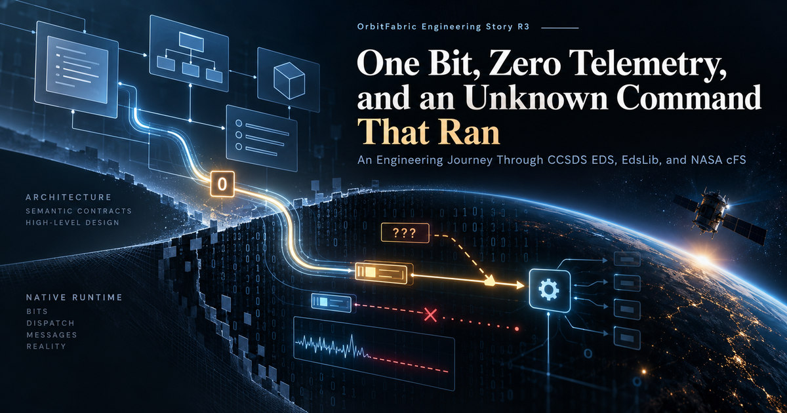

# One Bit, Zero Telemetry, and an Unknown Command That Ran



*An Engineering Journey Through CCSDS EDS, EdsLib, and NASA cFS*

The command reached its handler. The telemetry never arrived.

And that had not even been the first surprise. Before we reached runtime execution, a single Boolean field had stopped native generation. Later, a command selector that the declared interface did not recognize would reach a perfectly valid application handler.

Three apparently different observations had emerged from work that had begun with a very different objective: to find out whether an existing mission-level semantic contract could pass through a standards-backed interface and reach a genuine cFS environment, without either side giving up its own responsibilities.

The experiment was already well under way before I thought of documenting it as an Engineering Story. Some of its most revealing results were precisely the ones I had not expected.

To explain why I found them so interesting, I need to go back a little.

## One contract, different systems

OrbitFabric grew out of a problem I have encountered repeatedly in software and systems engineering: keeping the meaning of information consistent as it crosses different tools, components and engineering teams.

A command, a telemetry measurement or a verification expectation can appear in several artifacts. Each system has perfectly good reasons to represent it differently. The trouble starts when the representation changes and the meaning quietly changes with it.

With [OrbitFabric Core](https://github.com/OrbitFabric/orbitfabric), I have been exploring a model-first *Mission Data Contract*: define and validate mission semantics at a recognizable source, then make those facts available to downstream systems through explicit integration contracts.

Of course, defining a contract does not mean the integration problem is solved.

That is where the adapters became important.

I had been developing paths toward F Prime, OpenC3 COSMOS and OpenOBSW/OpenSVF, each with different native responsibilities. Some project contract declarations for flight software; others produce ground-facing artifacts or native verification procedures.

Those experiments reinforced a design principle that sounds straightforward on paper: an adapter needs to understand enough about its destination to produce something that destination can actually use, without asking the Mission Model to adopt the destination's internal architecture.

In practice, the interesting questions tend to appear right at that boundary.

## Why I wanted to explore a CCSDS EDS path

CCSDS Electronic Data Sheets were particularly intriguing to me.

EDS offered a way to explore a path where the intermediate representation was not a convention invented specifically for OrbitFabric, but a standardized description that an independent software toolchain could interpret.

That opened up an appealing possibility.

Start with facts already present in the mission contract. Project the supported subset into an EDS package. Then let the target's native tooling interpret and materialize that description, rather than building another private representation of the target inside OrbitFabric.

That was the motivation for the [OrbitFabric EDS-cFS adapter](https://github.com/OrbitFabric/orbitfabric-eds-cfs-adapter).

Given a coherent Core Integration Input Set and an explicit *Projection Profile*, its job was to produce a deterministic CCSDS EDS representation, accompanied by traceability and a checkable Integration Result.

But the most interesting part began immediately downstream.

In the selected path, [NASA EdsLib](https://github.com/nasa/EdsLib) would process the EDS descriptions and participate in generating the types and interfaces that a [cFS](https://github.com/nasa/cFS) application could actually consume. MissionLib and cFE would retain their own responsibilities for mission-specific message identity realization and native runtime behavior.

The path I wanted to investigate looked roughly like this:

```text
OrbitFabric Mission Data Contract
          |
          v
Core Integration Input Set
          |
          v
EDS-cFS Projection Profile
          |
          v
OrbitFabric EDS-cFS Adapter
          |
          v
CCSDS Electronic Data Sheets
          |
          v
NASA EdsLib / MissionLib
          |
          v
Generated native cFS interfaces
          |
          v
cFS application and runtime
```


At first glance, this might look like an ordinary sequence of transformations.

But each step introduces a different authority.

Core owns what the mission data means. The Profile states how we intend to bind it for a particular destination. The adapter produces that projection. The native tooling interprets the resulting artifact according to its own rules. Finally, the runtime executes code with its own architecture, configuration and operational policies.

And that raised a question I found difficult to ignore:

**How much of the original meaning really survives this chain, and which properties can we claim to have demonstrated only after the native system has had its say?**

Take a Boolean field.

To Core, its meaning does not depend on how a target chooses to store it. But once it reaches a toolchain that must generate native types and layouts, sizes, alignment and materialization rules enter the picture.

Or consider a telemetry message identity.

Its definition can be entirely consistent with the source contract and the generated EDS. That still does not guarantee that the selected numeric allocation is valid for the particular cFS mission we are running.

And what about an interface that declares which commands exist? How much does that declaration tell us about what the dispatcher will actually do when it receives an unexpected selector?

Those are different engineering questions. None is answered simply by observing that an EDS XML file was generated successfully.

Which was exactly why it seemed worth going further.

## From a working adapter to a native integration experiment

The initial goal was deliberately bounded: establish that a selected portion of the OrbitFabric semantic surface could be projected into CCSDS EDS deterministically, while preserving identities, traceability and explicit ownership.

That was already a useful result.

But once I had produced a representation intended for EdsLib, stopping at the XML would have left the most important question unanswered: **could the intended native consumer actually use what we had generated?**

So I began extending the experiment, one boundary at a time.

First came materialization through a precisely pinned EdsLib toolchain. Then came the build of a small cFS application that really depended on the generated interfaces.

I used `of_demo_app` for that purpose: an intentionally simple application with two typed commands and a status telemetry message.

Its simplicity mattered.

I was not trying to build another complex application, nor to suggest that OrbitFabric could generate an entire onboard software system. I wanted a native consumer small enough that I could follow the path end to end, but real enough that its implementation had to use what the target toolchain produced.

Remove the required generated interfaces, and the application build should fail. Deliver a command, and we should be able to observe which typed handler actually ran. Have that handler emit telemetry, and the message should travel through the cFS Software Bus and return to an EDS-aware host that could decode it.

By then, the experiment had become more than a check on the generated format.

It was forcing me to separate proof levels that are very easy, and sometimes very convenient, to confuse.

A correctly generated EDS package does not prove that EdsLib can materialize it.

Successful native generation does not prove that a real application can build and operate against those interfaces.

A compiling application does not prove that a command can travel correctly through the system.

And a command reaching its typed handler does not yet prove that the response telemetry has a valid path back out.

Each answer made the next question more precise.

Only later, once the nominal command path was observable, did it make sense to challenge less obvious assumptions. What would happen with a Function Code that the interface had not declared? Which constraints expressed in EDS would the runtime actually enforce?

I was not setting out to confirm answers I already knew. That was the point of using an independent toolchain, observing native behavior and keeping the uncomfortable results alongside the successful ones.

The integration work had already acquired an engineering life of its own. It was only afterwards, when I looked back over the observations, that I realized the sequence might be worth telling beyond the immediate adapter work.

That is how this Engineering Story came about.

And, looking back, I still find it striking that the first obstacle did not arise from an elaborate interaction between components or some unpredictable runtime behavior.

**It came much earlier. From a Boolean. From a single bit.**


## One bit: a semantic truth meets a storage rule

At the semantic level, `payload.enabled` was a boolean. The original target realization used `BASE_TYPES/StatusBit`, a one-bit field. In the abstract, that is not an unreasonable representation of a boolean.

It was not valid for the particular native path we had asked it to traverse.

The first B10 run got as far as EdsLib's DDS/IDL writer, then failed at `86-write_dds_idl.lua:87`. The relevant check required the emitted field count and bit width to resolve to whole bytes:

```text
(attribs.bitsize * count) % 8 == 0
```

The [retained original native log excerpt](https://github.com/OrbitFabric/orbitfabric-reference-mission/blob/4dae1391cade3d7a3be7d2bfc4f3f91106fab067/engineering-stories/03-standards-backed-path-to-cfs/evidence/b10-original-failure.log) shows the assertion and failed build step in [run 33968752308](https://github.com/OrbitFabric/orbitfabric-eds-cfs-adapter/actions/runs/33968752308).

This distinction is important: the observation does **not** prove that cFS, EdsLib or EDS universally prohibits one-bit fields. It proves that a standalone one-bit representation failed this pinned DDS/IDL generation boundary.

There were tempting ways to make the error disappear.

Changing the Core field to an integer would make a byte-aligned downstream type easy, but it would change the meaning of the source contract. Adding arbitrary padding in a surrounding container would also obscure where the storage decision belonged. Neither addressed the actual responsibility boundary cleanly.

The correction was adapter-local. Keep the semantic boolean, and generate an EDS boolean with explicit byte storage:

```xml
<BooleanDataType name="Boolean8">
  <BooleanDataEncoding sizeInBits="8" />
</BooleanDataType>
```

The resulting [public EDS fixture](https://github.com/OrbitFabric/orbitfabric-eds-cfs-adapter/blob/v0.1.1/tests/fixtures/p0_b6/expected.xml) still contains a boolean type, rather than an integer field disguised as one. The revised native generation completed, and a separate invalid-reference control still failed when it was supposed to.


The distinction between a positive and a negative control matters. In [B10 run 33980808658](https://github.com/OrbitFabric/orbitfabric-eds-cfs-adapter/actions/runs/33980808658), the EDS tool completed successfully; the harness then deliberately introduced an unresolved header reference and observed the expected rejection. The [selected log](https://github.com/OrbitFabric/orbitfabric-reference-mission/blob/4dae1391cade3d7a3be7d2bfc4f3f91106fab067/engineering-stories/03-standards-backed-path-to-cfs/evidence/b10-corrected-proof.log) retains both observations.

The lesson was not "store booleans as bytes everywhere". It was that a semantic contract and a wire or target representation are different authorities. The adapter could make the target-specific representation decision without changing the mission fact.

## A generated interface is not yet an operating application

After native generation, the next proof was designed to prevent another plausible shortcut.

It would have been easy to show that the adapter emitted EDS, point to the generated files, and call the integration successful. But a useful flight-software integration claim needs a consumer that actually depends on those interfaces.

The small `of_demo_app` served that purpose.

Its source includes `of_demo_eds_dictionary.h`, `of_demo_eds_dispatcher.h` and `of_demo_eds_typedefs.h`. The application registers typed handlers, subscribes to its command message ID and initializes the status telemetry message using the selected native allocation.

It is intentionally narrow. `PayloadEnableCmd` sets a flag and transmits telemetry. `PayloadSetPeriodCmd` records a period. It is not a flight application generator, a mission controller or a hidden mock of EdsLib.

The dependency was also tested negatively: remove the required generated EDS materialization and the native application must not continue to build as though nothing changed.

That made P1 useful. It established that the native target really consumed the projected interface.

It still did not establish that a command could make a valid round trip.

## Zero telemetry: when the target owns the number

The command was `payload.enable`. By the time the first runtime loop was assembled, the generated EDS interface was in use, and `of_demo_app` was ready to handle the command and publish its status. The incoming half worked. The telemetry half did not.

The first runtime loop provided the next answer.

The host used the native EDS-aware command path. `ci_lab` received the command. Generated dispatch reached `OF_DEMO_APP_PayloadEnableCmd`. The handler attempted to transmit `PayloadStatusTlm`.

The selected mission's telemetry topic was wrong. The [original native runtime excerpt](https://github.com/OrbitFabric/orbitfabric-reference-mission/blob/4dae1391cade3d7a3be7d2bfc4f3f91106fab067/engineering-stories/03-standards-backed-path-to-cfs/evidence/p2-original-invalid-topic.log) preserves the initial topic-to-MID mapping and the actual Software Bus rejection, rather than relying only on the corrected green run.

The initial reference binding used status telemetry TopicId `161`. In that particular SampleMission allocation, the value fell into the command-side range and mapped to `MsgId 0x00000000` for the telemetry conversion. The Software Bus rejected the result.

The command was not missing. The telemetry type was not missing. The target had a concrete identifier allocation that the integration had failed to respect.

The immediate diagnostic correction changed the selected mission's telemetry TopicId from `161` to `416`. In that native mission, `416` mapped to telemetry MID `0x0897`. The command-side topic `160` mapped to command MID `0x1897`.

The corrected test did what the generated EDS and a native cFS application were supposed to make possible:

```text
EDS cmd_send
    -> ci_lab
    -> generated OF_DEMO command dispatch
    -> PayloadEnableCmd typed handler
    -> CFE_SB_TransmitMsg
    -> to_lab
    -> EDS tlm_recv
    -> PayloadEnabled = true
```

In [run 34027854957](https://github.com/OrbitFabric/orbitfabric-eds-cfs-adapter/actions/runs/34027854957), the host decoder observed `PayloadEnabled=true`. The [retained native excerpt](https://github.com/OrbitFabric/orbitfabric-reference-mission/blob/4dae1391cade3d7a3be7d2bfc4f3f91106fab067/engineering-stories/03-standards-backed-path-to-cfs/evidence/p2-native-closed-loop.log) records runtime dispatch and decoded telemetry. That was a real positive loop for the exercised pinned application and host path.


But simply promoting `416` to a reusable default would have institutionalized the wrong solution.

The adapter did not own every future cFS mission's topic namespace. A number valid in SampleMission is not a universal property of `PayloadStatusTlm`.

The later correction was therefore architectural, not merely numeric.

The public Projection Profile came to bind the interface using a symbolic mission-owned reference:

```text
CFE_MISSION/OF_DEMO_STATUS_TLM_TOPICID
```

The selected cFS mission supplies the concrete number. MissionLib and cFE resolve the mapping for that mission. The adapter preserves the binding and fails closed if the required symbol cannot be resolved.

The historical `161 -> 416` change restored the experiment. The final `topic_ref` contract established who gets to make that decision in the future.

This is the sort of distinction that rarely appears in a release announcement but often decides whether an integration remains maintainable.

## Then the command we had not defined actually ran

The positive P2 loop created a new question.

Could we assume that a structurally valid command with an unknown Function Code would be rejected before reaching a valid application handler?

The EDS package declared two known OF_DEMO command derivatives. `FC 0` selected `payload.enable`; `FC 1` selected `payload.set_period`.

The negative test used Function Code `127`.

There was no corresponding command in the EDS declaration, so the test did not ask the EDS host encoder to invent one. It used the pinned host tool's **PassThrough** mode to create a valid CCSDS/cFS command header with an undefined selector and sent it through the normal `ci_lab` ingress path.

The observed packet bytes for that test were:

```text
18 97 c0 00 00 01 7f ce
```

In the frozen native run, the command arrived at the generated OF_DEMO typed dispatch and invoked `payload.enable`.

Not an unknown-command diagnostic. Not a safe drop observed at ingress. A valid handler.

The [P3 raw excerpt](https://github.com/OrbitFabric/orbitfabric-reference-mission/blob/4dae1391cade3d7a3be7d2bfc4f3f91106fab067/engineering-stories/03-standards-backed-path-to-cfs/evidence/p3-unknown-fc-characterization.log) retains the machine classification:

```text
unknown_function_code=127
host_encoder=PassThrough
classification=VALID_TYPED_HANDLER_INVOKED
valid_handler=payload.enable
```

It would be easy to turn that into an alarming statement about NASA flight software. The evidence does not justify doing so.

What the investigation established was more specific. On the pinned EdsLib dispatcher path, an unmatched derived command could fall through to dispatch-table position zero. Position zero was also the valid location for the first typed handler.

That made a boundary assumption false for this exercised combination.


A separate, disposable control was used to test the causal explanation. It distinguished a base container that genuinely had no derivatives, where position zero remained legitimate, from a base container with declared derivatives but no matching selector.

With that evidence-only intervention:

- `FC 0` still dispatched to `payload.enable`.
- `FC 1` still dispatched to `payload.set_period`.
- `FC 127` was rejected at generated OF_DEMO dispatch.
- A genuinely non-derived `SAMPLE_APP/SEND_HK` command still used its valid position-zero path.

That last control matters. A blanket ban on position zero might have "fixed" the one negative test while breaking an entirely valid command family.

The product adapter was not changed to install this intervention. The pinned EdsLib code used in the original observation was not silently replaced.

That left a question which the runtime evidence alone could not answer: **was the position-zero fallback intentional for a command family that declared derivatives but matched none of them?**

The distinction was not academic. Position zero is legitimate for a genuinely non-derived command. In the exercised derived family, however, an undefined selector had reached the first typed handler. Inspecting an earlier EdsLib dispatcher implementation also showed that the historical path had treated failed derivative identification differently. That comparison was worth raising, but did not by itself establish a regression.

So I opened [NASA EdsLib issue #120](https://github.com/nasa/EdsLib/issues/120), sharing the native observation, the separate causal control, and the relevant source history. I framed it as a question about **intended dispatch semantics**, without declaring an upstream defect or presenting the disposable intervention as a production patch.

The pinned runtime had shown what happened. The upstream question asks what behavior the interface is intended to guarantee. As of this Story, that clarification remains open.

### Why a green P3 workflow needs explanation

The first raw negative-conformance probe returned a nonzero exit status because the hypothesized rejection was falsified. Later steps gathered causal controls and evaluated whether the characterization was complete.

The final P3 acceptance was **PASS as CHARACTERIZATION**.

It was **not** PASS as automatic unknown-Function-Code rejection.

This distinction is encoded directly in the public [P3 acceptance script](https://github.com/OrbitFabric/orbitfabric-eds-cfs-adapter/blob/v0.1.1/.github/scripts/p3-acceptance.sh):

```text
acceptance_semantics=CHARACTERIZATION
prospective_automatic_rejection_property=FALSIFIED
automatic_unknown_fc_rejection_claim=false
adapter_runtime_guard_added=false
```

The [promoted proof workflow](https://github.com/OrbitFabric/orbitfabric-eds-cfs-adapter/actions/runs/34049249662) and [retained log selection](https://github.com/OrbitFabric/orbitfabric-reference-mission/blob/4dae1391cade3d7a3be7d2bfc4f3f91106fab067/engineering-stories/03-standards-backed-path-to-cfs/evidence/p3-unknown-fc-characterization.log) preserve both the uncomfortable observation and the accepted disposition.

There is one useful parallel in P2-B. The EDS type represented `PeriodMs` with `ValidRange 100..60000`. Yet the pinned host encoding and generated dispatch still delivered out-of-range values `99` and `60001` to the typed application handler. Representation of a constraint was observable; automatic enforcement by that path was not. The adapter therefore claimed faithful projection, not enforcement it had not proven.

A native system can accurately preserve a declaration and still implement a different runtime policy than its integrator expected.

## What was actually proven?

The original work produced more than a generated XML file, and considerably less than a universal flight-software guarantee.

| Gate | Native observation | Boundary of the claim |
| --- | --- | --- |
| **P0/B10** | Generated EDS materialized in pinned EdsLib after the Boolean8 correction; negative reference control rejected | Pinned byte-aligned DDS/IDL path, not all EDS targets |
| **P1** | Fixed cFS application compiled and consumed generated types and dispatcher | Dependency and build proof, not runtime behavior |
| **P2-A** | Generated command reached the typed handler and status returned as EDS-decoded `PayloadEnabled=true` | Selected SampleMission/OF_DEMO host/runtime path |
| **P2-B** | Range constraints projected faithfully; invalid values reached the native handler | Automatic range enforcement not established |
| **P3** | Undefined FC127 invoked a typed handler; causal controls explained the position-zero behavior | Characterization accepted, automatic rejection falsified |

The exact public product record is the [EDS-cFS Integration Coverage](https://github.com/OrbitFabric/orbitfabric-eds-cfs-adapter/blob/v0.1.1/coverage/integration-coverage.md). The [Story evidence manifest](https://github.com/OrbitFabric/orbitfabric-reference-mission/blob/4dae1391cade3d7a3be7d2bfc4f3f91106fab067/engineering-stories/03-standards-backed-path-to-cfs/evidence/README.md) retains selected original job-log excerpts and their hashes. Its excerpts are intentionally smaller than the full original Actions artifacts and make no claim of independent replay.

The native testing was performed on a pinned, software-based cFS environment. It is not evidence of execution on physical spacecraft hardware, complete EDS coverage or safety certification.

There is also a versioning distinction worth preserving. The integration's accepted native P0-P3 history belongs to the first public product release, `v0.1.0`, published on September 7, 2026. The current public [`v0.1.1` release](https://github.com/OrbitFabric/orbitfabric-eds-cfs-adapter/releases/tag/v0.1.1), dated September 25, normalized repository ownership and source coordinates without changing the relevant projection behavior. Historical run identifiers remain attached to their original baseline.

## The useful result was an ownership map


After the first native failure, a boolean looked like a type-mapping problem.

After the second, telemetry looked like a wrong number.

After the third, a green CI check could have looked like proof that a negative property held.

They were different problems, each exposing a different authority.

**The semantic contract owned what the mission meant.** Its boolean was not supposed to become an integer because a native generator wanted whole bytes.

**The adapter owned how that semantic value was realized for EDS.** It could choose Boolean8 without claiming that every target would require or prefer eight bits.

**The selected cFS mission owned its concrete topic allocation.** A portable Profile could bind the symbolic requirement, not legislate the number.

**The downstream runtime owned what its dispatcher and application actually did.** An EDS declaration was not, by itself, a runtime acceptance policy.

And **the evidence owned none of those authorities**. It could only show where our understanding matched observed behavior and where it failed.

This was the architectural result I had been looking for, though not in the form originally expected.

A standards-backed boundary matters because it makes integration inspectable. But a standards-backed artifact is not the end of interoperability proof.

The more interesting question is what survives after the native system gets to answer back.

---

**Continue exploring:** [Technical Deep Dive](technical-deep-dive.md) · [Native Proof Sources & Evidence](https://github.com/OrbitFabric/orbitfabric-reference-mission/tree/4dae1391cade3d7a3be7d2bfc4f3f91106fab067/engineering-stories/03-standards-backed-path-to-cfs) · [EDS-cFS Adapter](https://github.com/OrbitFabric/orbitfabric-eds-cfs-adapter) · [EdsLib Upstream Question #120](https://github.com/nasa/EdsLib/issues/120)

*This story reports a historical, bounded engineering investigation. No new native run or physical hardware test is implied by its publication.*
