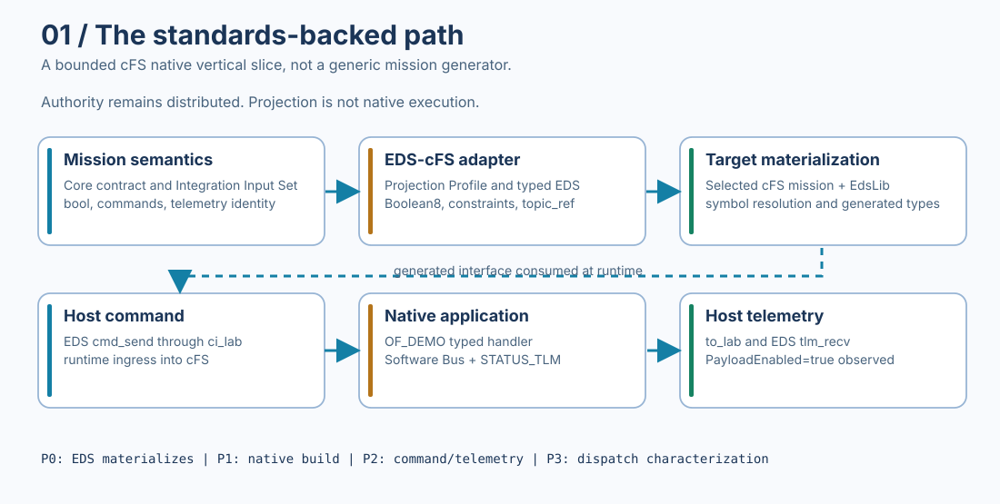
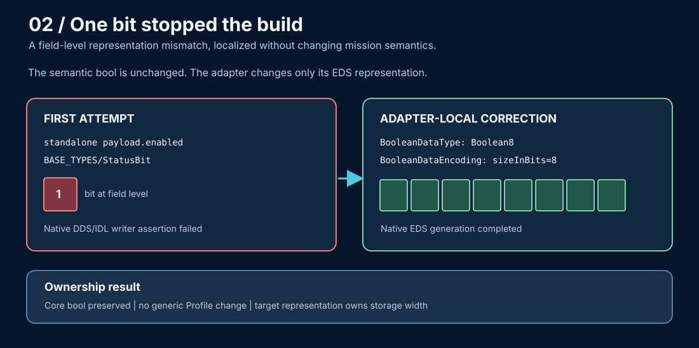
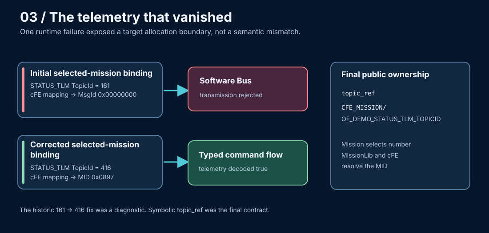
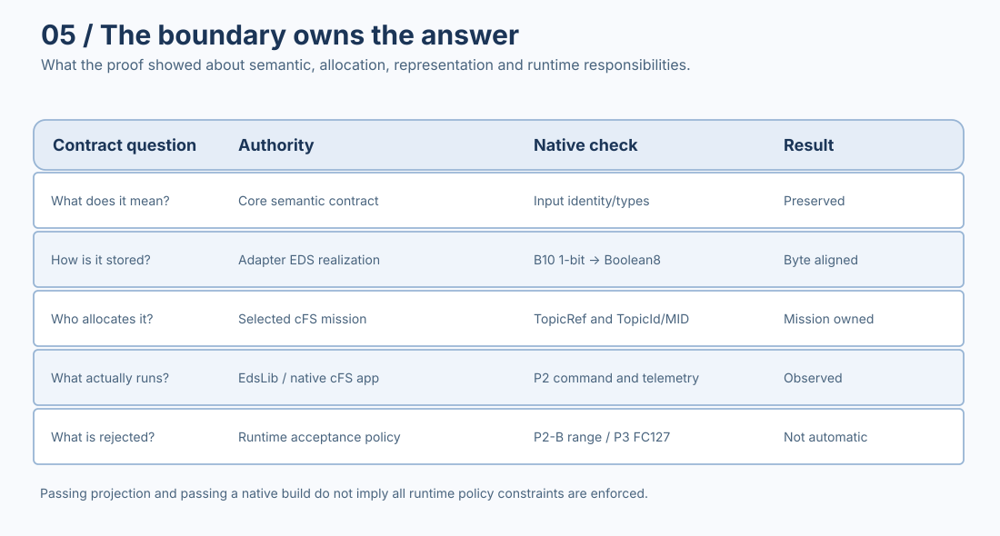

# One Bit, Zero Telemetry, and an Unknown Command That Ran

*An Engineering Journey Through CCSDS EDS, EdsLib, and NASA cFS*

The command reached its handler. The telemetry never arrived.

That was not the first surprise in this integration. Earlier, a single boolean field had stopped native generation. Later, an undefined command selector would reach a perfectly valid application handler.

All three observations came from a project that had started for an entirely different reason: to find out whether a mission-level semantic contract could travel through a standards-backed interface and arrive in a genuine cFS environment without either side surrendering its own responsibilities.

The experiment was already real before there was any intention to turn it into an Engineering Story. Its most useful findings were not the parts that behaved as expected.

## First, a command that seemed to work

The command was \`payload.enable\`.

By the time the first runtime test was assembled, the adapter had projected the selected mission definitions into an EDS package. A fixed test application, \`of_demo_app\`, consumed the generated native interface. Its \`PayloadEnableCmd\` handler set the \`PayloadEnabled\` telemetry field to true, then used \`CFE_SB_TransmitMsg\` to publish a status message.

The incoming part worked. The typed handler ran.

But the corresponding status telemetry could not be transmitted successfully.

A build passing would not have exposed this. EDS generation could establish a faithful representation. A native build could establish that the generated types and interfaces were consumable. Neither could prove that the selected mission's Software Bus identifiers were valid for the intended direction.

We had crossed one boundary and found another.

That became a recurring pattern. The integration did not consist of one obstacle called *cFS compatibility*. It consisted of separate ownership decisions. A type representation, a concrete topic allocation and a dispatch policy can each fail independently, even when everything immediately upstream is correct.

## Why a standards-backed path in the first place?

The [OrbitFabric EDS-cFS adapter](https://github.com/OrbitFabric/orbitfabric-eds-cfs-adapter) was built to pressure-test a specific architectural claim: semantic mission facts can be projected into a target-owned representation without having to insert target mechanics into the semantic source.

The relevant chain was:

\`\`\`text
mission contract
  -> integration input facts
  -> explicit EDS-cFS Projection Profile
  -> deterministic CCSDS EDS package
  -> NASA EdsLib and MissionLib materialization
  -> generated cFS native interfaces
  -> selected cFS application and runtime
\`\`\`

The adapter was not an attempt to make OrbitFabric become cFS. Nor was it a proposal that EDS alone could generate an operating spacecraft.

CCSDS Electronic Data Sheets provide a structured description of data types and interfaces. In the exercised [NASA EdsLib](https://github.com/nasa/EdsLib) and [cFS](https://github.com/nasa/cFS) toolchain, those descriptions could participate in target-native code generation and runtime message handling. That made the path interesting. The target was not a convenient fake consumer; it had rules and behaviors of its own.

The Proof of Concept progressively asked harder questions.

Could we emit a deterministic EDS package from existing facts? Could a pinned EdsLib lane materialize it? Could a small application build against the generated declarations rather than a handwritten surrogate? Could a host send an EDS-aware command and receive typed telemetry? And once the positive case worked, what would happen when the input was outside the declared command set?

These questions were motivated by integration design, not by publication. The later narrative follows the evidence they produced.

## One bit: a semantic truth meets a storage rule

The first failed assumption was remarkably small.

At the semantic level, \`payload.enabled\` was a boolean. The original target realization used \`BASE_TYPES/StatusBit\`, a one-bit field. In the abstract, that is not an unreasonable representation of a boolean.

It was not valid for the particular native path we had asked it to traverse.

The first B10 run got as far as EdsLib's DDS/IDL writer, then failed at \`86-write_dds_idl.lua:87\`. The relevant check required the emitted field count and bit width to resolve to whole bytes:

\`\`\`text
(attribs.bitsize * count) % 8 == 0
\`\`\`

The [retained original native log excerpt](https://github.com/OrbitFabric/orbitfabric-reference-mission/blob/main/engineering-stories/03-standards-backed-path-to-cfs/evidence/b10-original-failure.log) shows the assertion and failed build step in [run 33968752308](https://github.com/OrbitFabric/orbitfabric-eds-cfs-adapter/actions/runs/33968752308).

This distinction is important: the observation does **not** prove that cFS, EdsLib or EDS universally prohibits one-bit fields. It proves that a standalone one-bit representation failed this pinned DDS/IDL generation boundary.

There were tempting ways to make the error disappear.

Changing the Core field to an integer would make a byte-aligned downstream type easy, but it would change the meaning of the source contract. Adding arbitrary padding in a surrounding container would also obscure where the storage decision belonged. Neither addressed the actual responsibility boundary cleanly.

The correction was adapter-local. Keep the semantic boolean, and generate an EDS boolean with explicit byte storage:

\`\`\`xml
<BooleanDataType name="Boolean8">
  <BooleanDataEncoding sizeInBits="8" />
</BooleanDataType>
\`\`\`

The resulting [public EDS fixture](https://github.com/OrbitFabric/orbitfabric-eds-cfs-adapter/blob/v0.1.1/tests/fixtures/p0_b6/expected.xml) still contains a boolean type, rather than an integer field disguised as one. The revised native generation completed, and a separate invalid-reference control still failed when it was supposed to.

The distinction between a positive and a negative control matters. In [B10 run 33980808658](https://github.com/OrbitFabric/orbitfabric-eds-cfs-adapter/actions/runs/33980808658), the EDS tool completed successfully; the harness then deliberately introduced an unresolved header reference and observed the expected rejection. The [selected log](https://github.com/OrbitFabric/orbitfabric-reference-mission/blob/main/engineering-stories/03-standards-backed-path-to-cfs/evidence/b10-corrected-proof.log) retains both observations.

The lesson was not "store booleans as bytes everywhere". It was that a semantic contract and a wire or target representation are different authorities. The adapter could make the target-specific representation decision without changing the mission fact.

## A generated interface is not yet an operating application

After native generation, the next proof was designed to prevent another plausible shortcut.

It would have been easy to show that the adapter emitted EDS, point to the generated files, and call the integration successful. But a useful flight-software integration claim needs a consumer that actually depends on those interfaces.

The small \`of_demo_app\` served that purpose.

Its source includes \`of_demo_eds_dictionary.h\`, \`of_demo_eds_dispatcher.h\` and \`of_demo_eds_typedefs.h\`. The application registers typed handlers, subscribes to its command message ID and initializes the status telemetry message using the selected native allocation.

It is intentionally narrow. \`PayloadEnableCmd\` sets a flag and transmits telemetry. \`PayloadSetPeriodCmd\` records a period. It is not a flight application generator, a mission controller or a hidden mock of EdsLib.

The dependency was also tested negatively: remove the required generated EDS materialization and the native application must not continue to build as though nothing changed.

That made P1 useful. It established that the native target really consumed the projected interface.

It still did not establish that a command could make a valid round trip.

## Zero telemetry: when the target owns the number

The first runtime loop provided the next answer.

The host used the native EDS-aware command path. \`ci_lab\` received the command. Generated dispatch reached \`OF_DEMO_APP_PayloadEnableCmd\`. The handler attempted to transmit \`PayloadStatusTlm\`.

The selected mission's telemetry topic was wrong. The [original native runtime excerpt](https://github.com/OrbitFabric/orbitfabric-reference-mission/blob/main/engineering-stories/03-standards-backed-path-to-cfs/evidence/p2-original-invalid-topic.log) preserves the initial topic-to-MID mapping and the actual Software Bus rejection, rather than relying only on the corrected green run.

The initial reference binding used status telemetry TopicId \`161\`. In that particular SampleMission allocation, the value fell into the command-side range and mapped to \`MsgId 0x00000000\` for the telemetry conversion. The Software Bus rejected the result.

The command was not missing. The telemetry type was not missing. The target had a concrete identifier allocation that the integration had failed to respect.

The immediate diagnostic correction changed the selected mission's telemetry TopicId from \`161\` to \`416\`. In that native mission, \`416\` mapped to telemetry MID \`0x0897\`. The command-side topic \`160\` mapped to command MID \`0x1897\`.

The corrected test did what the generated EDS and a native cFS application were supposed to make possible:

\`\`\`text
EDS cmd_send
    -> ci_lab
    -> generated OF_DEMO command dispatch
    -> PayloadEnableCmd typed handler
    -> CFE_SB_TransmitMsg
    -> to_lab
    -> EDS tlm_recv
    -> PayloadEnabled = true
\`\`\`

In [run 34027854957](https://github.com/OrbitFabric/orbitfabric-eds-cfs-adapter/actions/runs/34027854957), the host decoder observed \`PayloadEnabled=true\`. The [retained native excerpt](https://github.com/OrbitFabric/orbitfabric-reference-mission/blob/main/engineering-stories/03-standards-backed-path-to-cfs/evidence/p2-native-closed-loop.log) records runtime dispatch and decoded telemetry. That was a real positive loop for the exercised pinned application and host path.

But simply promoting \`416\` to a reusable default would have institutionalized the wrong solution.

The adapter did not own every future cFS mission's topic namespace. A number valid in SampleMission is not a universal property of \`PayloadStatusTlm\`.

The later correction was therefore architectural, not merely numeric.

The public Projection Profile came to bind the interface using a symbolic mission-owned reference:

\`\`\`text
CFE_MISSION/OF_DEMO_STATUS_TLM_TOPICID
\`\`\`

The selected cFS mission supplies the concrete number. MissionLib and cFE resolve the mapping for that mission. The adapter preserves the binding and fails closed if the required symbol cannot be resolved.

The historical \`161 -> 416\` change restored the experiment. The final \`topic_ref\` contract established who gets to make that decision in the future.

This is the sort of distinction that rarely appears in a release announcement but often decides whether an integration remains maintainable.

## Then the command we had not defined actually ran

The positive P2 loop created a new question.

Could we assume that a structurally valid command with an unknown Function Code would be rejected before reaching a valid application handler?

The EDS package declared two known OF_DEMO command derivatives. \`FC 0\` selected \`payload.enable\`; \`FC 1\` selected \`payload.set_period\`.

The negative test used Function Code \`127\`.

There was no corresponding command in the EDS declaration, so the test did not ask the EDS host encoder to invent one. It used the pinned host tool's **PassThrough** mode to create a valid CCSDS/cFS command header with an undefined selector and sent it through the normal \`ci_lab\` ingress path.

The observed packet bytes for that test were:

\`\`\`text
18 97 c0 00 00 01 7f ce
\`\`\`

In the frozen native run, the command arrived at the generated OF_DEMO typed dispatch and invoked \`payload.enable\`.

Not an unknown-command diagnostic. Not a safe drop observed at ingress. A valid handler.

The [P3 raw excerpt](https://github.com/OrbitFabric/orbitfabric-reference-mission/blob/main/engineering-stories/03-standards-backed-path-to-cfs/evidence/p3-unknown-fc-characterization.log) retains the machine classification:

\`\`\`text
unknown_function_code=127
host_encoder=PassThrough
classification=VALID_TYPED_HANDLER_INVOKED
valid_handler=payload.enable
\`\`\`

It would be easy to turn that into an alarming statement about NASA flight software. The evidence does not justify doing so.

What the investigation established was more specific. On the pinned EdsLib dispatcher path, an unmatched derived command could fall through to dispatch-table position zero. Position zero was also the valid location for the first typed handler.

That made a boundary assumption false for this exercised combination.

A separate, disposable control was used to test the causal explanation. It distinguished a base container that genuinely had no derivatives, where position zero remained legitimate, from a base container with declared derivatives but no matching selector.

With that evidence-only intervention:

- \`FC 0\` still dispatched to \`payload.enable\`.
- \`FC 1\` still dispatched to \`payload.set_period\`.
- \`FC 127\` was rejected at generated OF_DEMO dispatch.
- A genuinely non-derived \`SAMPLE_APP/SEND_HK\` command still used its valid position-zero path.

That last control matters. A blanket ban on position zero might have "fixed" the one negative test while breaking an entirely valid command family.

The product adapter was not changed to install this intervention. The pinned EdsLib code used in the original observation was not silently replaced. The interpretation remained bounded pending upstream clarification, tracked in [nasa/EdsLib issue #120](https://github.com/nasa/EdsLib/issues/120).

### Why a green P3 workflow needs explanation

The first raw negative-conformance probe returned a nonzero exit status because the hypothesized rejection was falsified. Later steps gathered causal controls and evaluated whether the characterization was complete.

The final P3 acceptance was **PASS as CHARACTERIZATION**.

It was **not** PASS as automatic unknown-Function-Code rejection.

This distinction is encoded directly in the public [P3 acceptance script](https://github.com/OrbitFabric/orbitfabric-eds-cfs-adapter/blob/v0.1.1/.github/scripts/p3-acceptance.sh):

\`\`\`text
acceptance_semantics=CHARACTERIZATION
prospective_automatic_rejection_property=FALSIFIED
automatic_unknown_fc_rejection_claim=false
adapter_runtime_guard_added=false
\`\`\`

The [promoted proof workflow](https://github.com/OrbitFabric/orbitfabric-eds-cfs-adapter/actions/runs/34049249662) and [retained log selection](https://github.com/OrbitFabric/orbitfabric-reference-mission/blob/main/engineering-stories/03-standards-backed-path-to-cfs/evidence/p3-unknown-fc-characterization.log) preserve both the uncomfortable observation and the accepted disposition.

There is one useful parallel in P2-B. The EDS type represented \`PeriodMs\` with \`ValidRange 100..60000\`. Yet the pinned host encoding and generated dispatch still delivered out-of-range values \`99\` and \`60001\` to the typed application handler. Representation of a constraint was observable; automatic enforcement by that path was not. The adapter therefore claimed faithful projection, not enforcement it had not proven.

A native system can accurately preserve a declaration and still implement a different runtime policy than its integrator expected.

## What was actually proven?

The original work produced more than a generated XML file, and considerably less than a universal flight-software guarantee.

| Gate | Native observation | Boundary of the claim |
| --- | --- | --- |
| **P0/B10** | Generated EDS materialized in pinned EdsLib after the Boolean8 correction; negative reference control rejected | Pinned byte-aligned DDS/IDL path, not all EDS targets |
| **P1** | Fixed cFS application compiled and consumed generated types and dispatcher | Dependency and build proof, not runtime behavior |
| **P2-A** | Generated command reached the typed handler and status returned as EDS-decoded \`PayloadEnabled=true\` | Selected SampleMission/OF_DEMO host/runtime path |
| **P2-B** | Range constraints projected faithfully; invalid values reached the native handler | Automatic range enforcement not established |
| **P3** | Undefined FC127 invoked a typed handler; causal controls explained the position-zero behavior | Characterization accepted, automatic rejection falsified |

The exact public product record is the [EDS-cFS Integration Coverage](https://github.com/OrbitFabric/orbitfabric-eds-cfs-adapter/blob/v0.1.1/coverage/integration-coverage.md). The [Story evidence manifest](https://github.com/OrbitFabric/orbitfabric-reference-mission/blob/main/engineering-stories/03-standards-backed-path-to-cfs/evidence/README.md) retains selected original job-log excerpts and their hashes. Its excerpts are intentionally smaller than the full original Actions artifacts and make no claim of independent replay.

The native testing was performed on a pinned, software-based cFS environment. It is not evidence of execution on physical spacecraft hardware, complete EDS coverage or safety certification.

There is also a versioning distinction worth preserving. The integration's accepted native P0-P3 history belongs to the first public product release, \`v0.1.0\`, published on September 7, 2026. The current public [\`v0.1.1\` release](https://github.com/OrbitFabric/orbitfabric-eds-cfs-adapter/releases/tag/v0.1.1), dated September 25, normalized repository ownership and source coordinates without changing the relevant projection behavior. Historical run identifiers remain attached to their original baseline.

## The useful result was an ownership map

After the first native failure, a boolean looked like a type-mapping problem.

After the second, telemetry looked like a wrong number.

After the third, a green CI check could have looked like proof that a negative property held.

They were different problems, each exposing a different authority.

**The semantic contract owned what the mission meant.** Its boolean was not supposed to become an integer because a native generator wanted whole bytes.

**The adapter owned how that semantic value was realized for EDS.** It could choose Boolean8 without claiming that every target would require or prefer eight bits.

**The selected cFS mission owned its concrete topic allocation.** A portable Profile could bind the symbolic requirement, not legislate the number.

**The downstream runtime owned what its dispatcher and application actually did.** An EDS declaration was not, by itself, a runtime acceptance policy.

And **the evidence owned none of those authorities**. It could only show where our understanding matched observed behavior and where it failed.

This was the architectural result I had been looking for, though not in the form originally expected.

A standards-backed boundary matters because it makes integration inspectable. But a standards-backed artifact is not the end of interoperability proof.

The more interesting question is what survives after the native system gets to answer back.

---

**Inspect the engineering evidence:** [R3 Reference Project and provenance](https://github.com/OrbitFabric/orbitfabric-reference-mission/tree/main/engineering-stories/03-standards-backed-path-to-cfs) · [Technical Deep Dive](technical-deep-dive.md) · [EDS-cFS adapter](https://github.com/OrbitFabric/orbitfabric-eds-cfs-adapter) · [EdsLib upstream clarification](https://github.com/nasa/EdsLib/issues/120)

*This story reports a historical, bounded engineering investigation. No new native run or physical hardware test is implied by its publication.*
