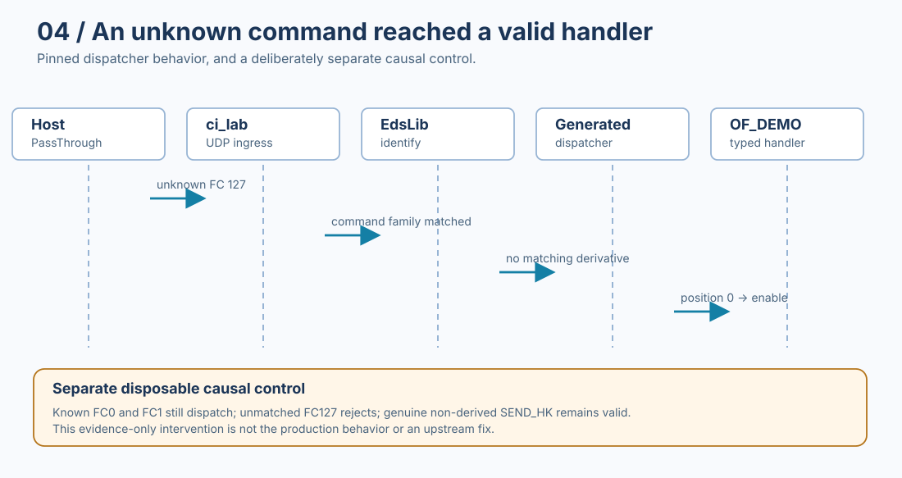

# Technical Deep Dive: A Standards-Backed Path to cFS

The [R3 Engineering Story](index.md) follows a real sequence of engineering surprises. This appendix pins the native systems, source files, proof boundaries and evidence needed to inspect those claims.

This document describes **historical** adapter-native proofs. No new EdsLib or cFS execution was run for the Story itself.

## 1. Source and runtime baseline

| Component | Frozen reference or identity | Role |
| --- | --- | --- |
| OrbitFabric EDS-cFS adapter | [v0.1.0 historical proof](https://github.com/OrbitFabric/orbitfabric-eds-cfs-adapter/releases/tag/v0.1.0) | Original accepted native P0-P3 proof and source lineage |
| EDS-cFS adapter current public release | [v0.1.1](https://github.com/OrbitFabric/orbitfabric-eds-cfs-adapter/releases/tag/v0.1.1) | Current owner and Source Coordinate metadata; no projection-behavior expansion |
| NASA cFS | `088b2fa828db9ff7e00733f1908e0eeb59f66ce3` | Selected pinned flight software tree |
| NASA EdsLib | `2acc963b34f77692c6396555dcfb10ef43eb1046` | Native generation and runtime dispatch |
| NASA cFE | `c5fb2b4d540bd55eb6c3707da7dd13eee679d4dd` | Software Bus and runtime |
| NASA ci_lab | `f5d36625336249312ee9d5815bc875e231815bb4` | Host command ingress |
| NASA to_lab | `38f7312ec4c1109b8f1c0738730b6e5ac5860f05` | Host telemetry |
| NASA command-line tools | `d70c56ec035694c9a64b317897403266166f5d68` | EDS host send/receive and P3 PassThrough probe |

The exact source pins above appear in the public [P2 runtime proof script](https://github.com/OrbitFabric/orbitfabric-eds-cfs-adapter/blob/v0.1.1/.github/scripts/p2-runtime-proof.sh), except that the frozen NASA `sample_app` control has its own pin in the [P3 causal control](https://github.com/OrbitFabric/orbitfabric-eds-cfs-adapter/blob/v0.1.1/.github/scripts/p3-edslib-derived-dispatch-control.sh).

Use these **historical pins** when discussing original execution. A checkout of whatever upstream `main` happens to contain today does not reproduce them.

The public adapter [Integration Coverage](https://github.com/OrbitFabric/orbitfabric-eds-cfs-adapter/blob/v0.1.1/coverage/integration-coverage.md) explicitly distinguishes projection, native build, runtime observation and characterization.

## 2. Source and target responsibilities

| Area | Owner | Specific demonstrated responsibility |
| --- | --- | --- |
| Boolean value and command meaning | OrbitFabric semantic input | Preserve the `bool`, command IDs, telemetry identities, types and constraints |
| Type and interface realization | EDS-cFS adapter | Render a deterministic EDS package and target-local `Boolean8` |
| Reference to concrete TopicIds | Projection Profile | Express required mission symbols as `topic_ref`, not universal numerical allocations |
| Concrete TopicId allocation | Selected cFS mission | Supply `OF_DEMO_CMD_TOPICID` and `OF_DEMO_STATUS_TLM_TOPICID` |
| Concrete MsgId construction | MissionLib/cFE | Resolve selected topic mapping for the active mission |
| Native generation and dispatch | EdsLib plus cFS build | Generate/consume typed interfaces and apply real dispatcher behavior |
| Command-specific response | Fixed `of_demo_app` | Execute typed handler and publish status telemetry |
| Policy beyond native representation | Selected target and application | Enforce range/selector rules only if implemented and evidenced |

The [generated EDS fixture](https://github.com/OrbitFabric/orbitfabric-eds-cfs-adapter/blob/v0.1.1/tests/fixtures/p0_b6/expected.xml) demonstrates the target representation. It contains both `Boolean8` and `ValidRange` as well as the symbolic TopicId initial values. The generated interface references are not a claim that every runtime validates every representation constraint.

## 3. P0 and B10: byte alignment without semantic mutation

### Original falsification

The early standalone `payload.enabled` realization used `BASE_TYPES/StatusBit` with a 1-bit width. The frozen EDS generation advanced far enough to exercise the DDS/IDL writer, then failed at:

```text
tools/eds/cfecfs/missionlib/eds/86-write_dds_idl.lua:87
```

The assertion checked a whole-byte multiple at the field writer boundary:

```lua
assert((attribs.bitsize * count) % 8 == 0)
```

The [first B10 log excerpt](https://github.com/OrbitFabric/orbitfabric-reference-mission/blob/4dae1391cade3d7a3be7d2bfc4f3f91106fab067/engineering-stories/03-standards-backed-path-to-cfs/evidence/b10-original-failure.log) is from [run 33968752308](https://github.com/OrbitFabric/orbitfabric-eds-cfs-adapter/actions/runs/33968752308). It contains the writer assertion and failing make target. It does not by itself preserve the original `StatusBit` XML. The original representation and its root-cause attribution are historical engineering facts established during the native investigation, not text extracted from the job-log excerpt.

### Bounded correction and controls

The adapter-local correction defined:

```xml
<BooleanDataType name="Boolean8">
  <BooleanDataEncoding sizeInBits="8" />
</BooleanDataType>
```

The relevant field continues to use a boolean rather than being recast as a generic integer. The source Core contract and Projection Profile do not acquire a `bool`-width configuration rule.

B10 had to pass its real generation and still reject invalid input. [Run 33980808658](https://github.com/OrbitFabric/orbitfabric-eds-cfs-adapter/actions/runs/33980808658) records generation completion and a deliberate unresolved-reference negative control. The [curated excerpt](https://github.com/OrbitFabric/orbitfabric-reference-mission/blob/4dae1391cade3d7a3be7d2bfc4f3f91106fab067/engineering-stories/03-standards-backed-path-to-cfs/evidence/b10-corrected-proof.log) preserves both. The [native B10 script](https://github.com/OrbitFabric/orbitfabric-eds-cfs-adapter/blob/v0.1.1/.github/scripts/b10-native-edslib.sh) is the reproducible operation boundary.

This proves the exercised byte-aligned writer accepts the corrected EDS type, not a universal rule about all one-bit EDS types.

## 4. P1 and P2: the native application and Software Bus

The fixed application source is [`of_demo_app.c`](https://github.com/OrbitFabric/orbitfabric-eds-cfs-adapter/blob/v0.1.1/examples/cfs/of_demo_app/fsw/src/of_demo_app.c). Among its native dependencies are:

```c
#include "cfe_mission_eds_designparameters.h"
#include "of_demo_eds_dictionary.h"
#include "of_demo_eds_dispatcher.h"
#include "of_demo_eds_typedefs.h"
```

Its command handler sets `StatusTlm.Payload.PayloadEnabled = true`, then calls `CFE_SB_TransmitMsg` with the initialized telemetry header. A missing-generated-interface build control guards against silently bypassing the target toolchain.

The first P2 issue was a **mission mapping mismatch**:

| Path | Selected topic | Computed MID | Observation |
| --- | --- | --- | --- |
| Initial status telemetry | 161 | `0x00000000` | Invalid for intended telemetry transmission |
| Corrected SampleMission status telemetry | 416 | `0x0897` | Transmitted and EDS-decoded |
| Command path in selected SampleMission | 160 | `0x1897` | Native command dispatch works |

These are values of the **selected sample mission**, not a reusable OrbitFabric allocation table. The [original failed P2 runtime source](https://github.com/OrbitFabric/orbitfabric-reference-mission/blob/4dae1391cade3d7a3be7d2bfc4f3f91106fab067/engineering-stories/03-standards-backed-path-to-cfs/evidence/p2-original-invalid-topic.log) is retained from a digest-verified Actions archive. The [corrected native acceptance record](https://github.com/OrbitFabric/orbitfabric-reference-mission/blob/4dae1391cade3d7a3be7d2bfc4f3f91106fab067/engineering-stories/03-standards-backed-path-to-cfs/evidence/p2-a-acceptance.txt) is separately retained.

The later public Profile references:

```yaml
topic_ref: CFE_MISSION/OF_DEMO_STATUS_TLM_TOPICID
```

The exact key placement can be inspected in the [public P0/B3 profile](https://github.com/OrbitFabric/orbitfabric-eds-cfs-adapter/blob/v0.1.1/tests/fixtures/p0_b3/profile.yaml). The target mission supplies the allocation; EdsLib/MissionLib resolves it. The native validation includes a missing-symbol fail-closed case.

The successful P2 runtime path was:

```text
host cmd_send with EDS-selected command
 -> ci_lab ingress
 -> generated EDS dispatcher
 -> OF_DEMO PayloadEnableCmd handler
 -> CFE_SB_TransmitMsg
 -> to_lab telemetry
 -> host tlm_recv with EDS decode
 -> PayloadEnabled=true
```

The original host/runtime result is [run 34027854957](https://github.com/OrbitFabric/orbitfabric-eds-cfs-adapter/actions/runs/34027854957), with its [selected output retained here](https://github.com/OrbitFabric/orbitfabric-reference-mission/blob/4dae1391cade3d7a3be7d2bfc4f3f91106fab067/engineering-stories/03-standards-backed-path-to-cfs/evidence/p2-native-closed-loop.log).

### P2-B: representation is not runtime range checking

The generated EDS declares `PeriodMs` inclusive `100..60000`. The pinned host encoder and native generated dispatch delivered test values `1000`, `99` and `60001` to the handler.

The public coverage record classifies this as *characterized, not automatic enforcement*. No new guard was added to the adapter.

This is an important negative claim: successful interface materialization is not evidence that application-level acceptance policies are present.

## 5. P3: undefined Function Code and the derived-dispatch fallback

Two positive OF_DEMO command derivatives were declared:

- `FC 0` maps to `PayloadEnableCmd`;
- `FC 1` maps to `PayloadSetPeriodCmd`.

The negative probe used undefined `FC 127` in an otherwise coherent native command header:

```text
18 97 c0 00 00 01 7f ce
```

Because `FC 127` is not a known EDS-derived command, the host tool's **PassThrough** encoder was deliberately used for injection. This bypassed the host EDS *encoding selection* but not the `ci_lab` ingress and native dispatcher being investigated.

The raw observed classification was:

```text
classification=VALID_TYPED_HANDLER_INVOKED
valid_handler=payload.enable
```

The [source run](https://github.com/OrbitFabric/orbitfabric-eds-cfs-adapter/actions/runs/34049249662) and [retained job-log selection](https://github.com/OrbitFabric/orbitfabric-reference-mission/blob/4dae1391cade3d7a3be7d2bfc4f3f91106fab067/engineering-stories/03-standards-backed-path-to-cfs/evidence/p3-unknown-fc-characterization.log) preserve that outcome.

### Causal control, not production patch

The frozen EdsLib dispatcher path was found to use dispatch-table position zero if derived-type matching did not select a more specific entry. That fallback was ambiguous between two situations:

1. A genuinely non-derived command, where the only valid handler is at index zero.
2. A command base with derivatives, where a supplied selector matches none of them.

A **disposable evidence-only intervention** distinguished the two cases. It rejected the unmatched-derived case while retaining positive FC0, FC1, and the genuine `SAMPLE_APP/SEND_HK` non-derived path.

The exact scripts are [P3 raw probe](https://github.com/OrbitFabric/orbitfabric-eds-cfs-adapter/blob/v0.1.1/.github/scripts/p3-conformance-proof.sh), [causal control](https://github.com/OrbitFabric/orbitfabric-eds-cfs-adapter/blob/v0.1.1/.github/scripts/p3-edslib-derived-dispatch-control.sh), and [final acceptance](https://github.com/OrbitFabric/orbitfabric-eds-cfs-adapter/blob/v0.1.1/.github/scripts/p3-acceptance.sh).



The decisive acceptance assertions include:

```text
status=PASS
acceptance_semantics=CHARACTERIZATION
prospective_automatic_rejection_property=FALSIFIED
genuine_nonderived_regression=PASS
automatic_unknown_fc_rejection_claim=false
adapter_runtime_guard_added=false
```

The green P3 workflow does **not** mean the original native runtime rejects unknown FC127. It means the original contrary behavior and the causal control were reproducibly characterized.

An upstream intended-semantics question is tracked in [NASA EdsLib issue #120](https://github.com/nasa/EdsLib/issues/120). Until an authoritative resolution, the Story must not classify the fallback as a universal EdsLib defect or security vulnerability. It also must not claim that the disposable control exists in the shipped product.

## 6. Source-level dispatch trace: where the ambiguity enters

The Story reports that an undefined Function Code reached a valid handler. This section follows the **pinned native source** to explain the narrower causal chain and the question left open for upstream maintainers. It is a source reading tied to the historical P3 observations, not a newly executed native experiment.

### 6.1 From the received buffer to an argument type

In the pinned [EdsLib dispatcher, `CFE_EDSMSG_Dispatch()`](https://github.com/nasa/EdsLib/blob/2acc963b34f77692c6396555dcfb10ef43eb1046/cfecfs/edsmsg/fsw/src/edsmsg_dispatcher.c#L305-L357), the received Software Bus buffer passes through topic and component checks. If the component matches, the dispatcher calls `CFE_EDSMSG_Dispatch_FindArgType()` to establish an argument type and a dispatch-table position.

The decision chain in the exercised source is:

```text
CFE_EDSMSG_Dispatch
  -> GetTopicInfo / CheckComponentMatch
  -> FindArgType
       -> FindArgBaseType
       -> CheckActualBufferType
            -> IdentifyBufferWithSize(base type, received buffer)
               SUCCESS:
                 use identified derived type and its table index
               non-SUCCESS:
                 keep base type and select dispatch position 0
            -> GetTypeInfo(selected type)
            -> compare declared byte size with received message size
  -> if CFE_SUCCESS, LookupHandler(dispatch position)
  -> if handler exists, invoke Handler(buffer)
```

The critical transition is in [`CFE_EDSMSG_Dispatch_CheckActualBufferType()`, lines 202-249](https://github.com/nasa/EdsLib/blob/2acc963b34f77692c6396555dcfb10ef43eb1046/cfecfs/edsmsg/fsw/src/edsmsg_dispatcher.c#L202-L249). On successful identification, the dispatcher selects the derived EDS type and the corresponding `DerivativeTableIndex`. On a non-success result, it selects **position zero** and retains the base type.

The subsequent `GetTypeInfo()` and message-length check still run. A non-matching selector therefore does **not** imply that every malformed command passes. In the exercised FC127 packet, the remaining checks allowed lookup of position zero, which resolved to the valid `payload.enable` handler. That is the bounded observed result.

### 6.2 Where the no-match status originates

The dispatcher does not itself decode a Function Code and classify it as unknown. It delegates derived-type identification to `EdsLib_DataTypeDB_IdentifyBufferWithSize()`.

The [pinned API implementation](https://github.com/nasa/EdsLib/blob/2acc963b34f77692c6396555dcfb10ef43eb1046/edslib/fsw/src/edslib_datatypedb_api.c#L1191-L1230) returns the result of `EdsLib_DataTypeIdentifyBuffer_Impl()`. In the [pinned constraint implementation](https://github.com/nasa/EdsLib/blob/2acc963b34f77692c6396555dcfb10ef43eb1046/edslib/fsw/src/edslib_datatypedb_constraints.c#L567-L611), the result starts as `EDSLIB_NO_MATCHING_VALUE` and becomes `EDSLIB_SUCCESS` only if an identification sequence yields a matching derivative. Other unsuccessful outcomes can exist, so the broad non-success branch in the dispatcher must not be described as exclusively handling unknown Function Codes.

The resulting ambiguity is about **two different meanings of an unsuccessful derivative-identification attempt**:

| Base argument type | Identification outcome | Position-zero question |
| --- | --- | --- |
| Has declared derivatives and the selector matches | Success with derived type and table index | No fallback needed |
| Has declared derivatives but the selector matches none | No matching derivative | Should this select the first handler or fail? |
| Has no derivatives | No derived type to select | Position zero may legitimately identify the sole handler |

The original pinned dispatcher maps both unsuccessful situations to position zero. The P3 test falsified an assumed automatic rejection property for the particular OF_DEMO family. It did not establish a universal dispatch-safety classification.

### 6.3 The earlier implementation and the isolated causal control

An [earlier EdsLib dispatcher implementation](https://github.com/nasa/EdsLib/blob/7eb94477c5aa32a2dba1f342df720a56722821a1/cfecfs/edsmsg/fsw/src/cfe_msg_dispatcher.c#L111-L138) used native MissionLib metadata to distinguish the presence of subcommands. When `SubcommandArgumentId == 1` and `NumSubcommands > 0`, a failed derived identification returned `CFE_STATUS_UNKNOWN_MSG_ID`. A genuinely non-derived command did not enter that derived-command branch.

This is a **historical implementation difference**, not by itself proof that the later implementation introduced a defect. The intended semantics of the newer path remain an upstream question.

For the separate P3 causal control, the [public evidence-only script](https://github.com/OrbitFabric/orbitfabric-eds-cfs-adapter/blob/v0.1.1/.github/scripts/p3-edslib-derived-dispatch-control.sh) temporarily changed the disposable native build to consult `EdsLib_DataTypeDB_GetDerivedInfo()` and `NumDerivatives` after unsuccessful identification:

```text
identification did not succeed
  -> read base-type derivative metadata
     metadata error OR NumDerivatives > 0
       -> CFE_STATUS_VALIDATION_FAILURE
     otherwise
       -> retain legitimate position-zero path
```

This was a **test intervention**, not an adapter change, an accepted EdsLib patch, or a proposed general-purpose policy. It was designed to discriminate between the two interpretations while retaining both positive derived commands and a genuinely non-derived command.

| Probe | Unmodified pinned runtime | Disposable causal control |
| --- | --- | --- |
| OF_DEMO FC0 | Typed `payload.enable` observed | Typed `payload.enable` preserved |
| OF_DEMO FC1 | Typed `payload.set_period` observed | Typed `payload.set_period` preserved |
| OF_DEMO FC127, no declared derivative | `payload.enable` invoked unexpectedly | Rejected at generated OF_DEMO dispatch |
| NASA `SAMPLE_APP/SEND_HK`, genuinely non-derived | No separate baseline claim made here | Legitimate position-zero handler observed |

The separately retained [FC127 observation](https://github.com/OrbitFabric/orbitfabric-reference-mission/blob/4dae1391cade3d7a3be7d2bfc4f3f91106fab067/engineering-stories/03-standards-backed-path-to-cfs/evidence/p3-unknown-function-code-result.txt) and [causal-control result](https://github.com/OrbitFabric/orbitfabric-reference-mission/blob/4dae1391cade3d7a3be7d2bfc4f3f91106fab067/engineering-stories/03-standards-backed-path-to-cfs/evidence/p3-edslib-causal-control.txt) are native records extracted from the historical Actions archive. The [P3 acceptance script](https://github.com/OrbitFabric/orbitfabric-eds-cfs-adapter/blob/v0.1.1/.github/scripts/p3-acceptance.sh) classifies the complete result as `CHARACTERIZATION`, with the prospective automatic-rejection property `FALSIFIED`.

### 6.4 Why the question was taken upstream

After the observed dispatch and causal controls, one ownership boundary remained: defining the **intended** behavior of the native dispatcher. On September 7, 2026, [NASA EdsLib issue #120](https://github.com/nasa/EdsLib/issues/120) was opened as a request for clarification, with the runtime bytes, source path, prior implementation, distinct control cases, and evidence-only intervention.

The issue asks whether position-zero fallback is intentional when a base argument has registered derivatives but no selector matches, whether the genuinely non-derived case should be distinguished, and which dispatch status would be appropriate if unmatched derived commands are intended to fail. It does **not** assert an upstream vulnerability or submit the disposable experiment as a production fix.

The issue remains open, with no upstream resolution incorporated into this historical proof. Reproducing the observation and clarifying intended semantics are separate steps; neither should be substituted for the other.

## 7. Retained evidence and integrity

The [retained R3 evidence index](https://github.com/OrbitFabric/orbitfabric-reference-mission/blob/4dae1391cade3d7a3be7d2bfc4f3f91106fab067/engineering-stories/03-standards-backed-path-to-cfs/evidence/README.md) provides:

- original workflow links and job IDs;
- 1-based source-log line ranges;
- small verbatim excerpts retained in this repository;
- SHA-256 for each complete curated excerpt;
- distinct original ZIP artifact IDs, ZIP digests and expiration dates;
- explicit limitations on what any single excerpt establishes.

This is **source preservation**, not newly generated evidence. It reduces reliance on expiring Actions archives without pretending that extracted lines replace every artifact inside those archives.

Inspect the actual generated EDS fixture and application source when evaluating structural claims. Inspect the native scripts for control behavior. Inspect historical job-log excerpts for runtime observations. Use the three together rather than allowing any one to stand in for the others.

## 8. Bounded reproduction entrypoint

The [Reference Project](https://github.com/OrbitFabric/orbitfabric-reference-mission/tree/4dae1391cade3d7a3be7d2bfc4f3f91106fab067/engineering-stories/03-standards-backed-path-to-cfs/reference-project) indexes the exact proof scripts, pins, source inputs and expected observations. The native project is owned by the adapter repository; R3 does not fork `of_demo_app` or maintain a second EDS implementation.

A person attempting to reproduce the historical lane should:

1. Check out the accepted adapter tag, consult its scripts, and verify the pinned source identities.
2. Run the B10 native proof with both successful materialization and negative controls.
3. Build the fixed application against generated EDS interfaces.
4. Exercise P2 via the native host command/telemetry path and confirm EDS-decoded `PayloadEnabled=true`.
5. For P3, inspect the raw FC127 falsification and the **separate** causal control. Never treat green characterization as an unknown-command rejection guarantee.

These workflows have native dependencies and require an appropriate Linux build environment. Their historical acceptance does not guarantee that every modern runner, upstream dependency or arbitrary selected cFS mission will reproduce the same result without environment parity.

## 9. Final interpretation

The Story verifies one standards-backed target path with meaningful native behavior. It does not prove a generic spacecraft generator, all EDS constraints enforced at runtime, automatic unknown-command rejection, deployed flight hardware or unqualified cFS security.

The engineering question was not "Did EDS work?" It was where semantic intent stopped, where target realization began, and which runtime guarantees remained unproven when the system was allowed to behave natively.
